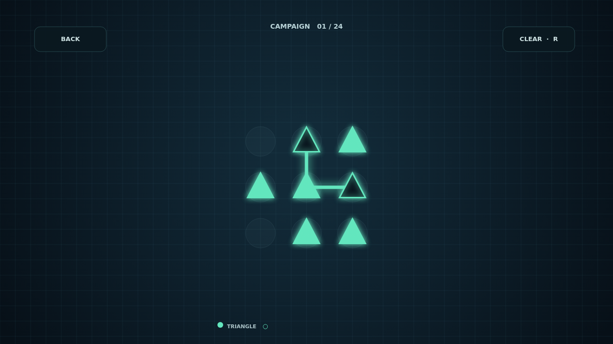

# Trace the light

Refract is a puzzle played with beams of light. Each board is a small optical bench: connect a channel's two emitters while threading its lenses, then make sure every crystal has spent all of its charges.

Press a node and drag to draw. Your beam follows adjacent nodes, including diagonals, while blocked moves simply leave the route in place. Every route is yours to shape, and a completed board is a satisfying pattern of colored light.

Campaign takes you through 24 hand-built boards, unlocking them one at a time. Cascade keeps dealing new boards and raises the challenge as you solve them. Choose a quiet, careful run or keep climbing for as long as you like.

